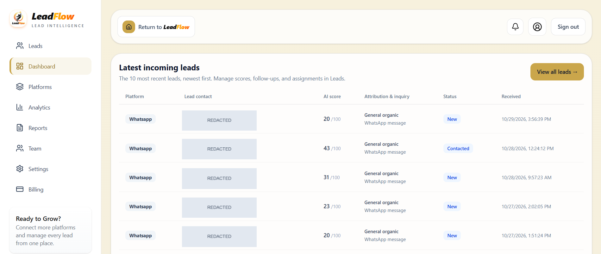
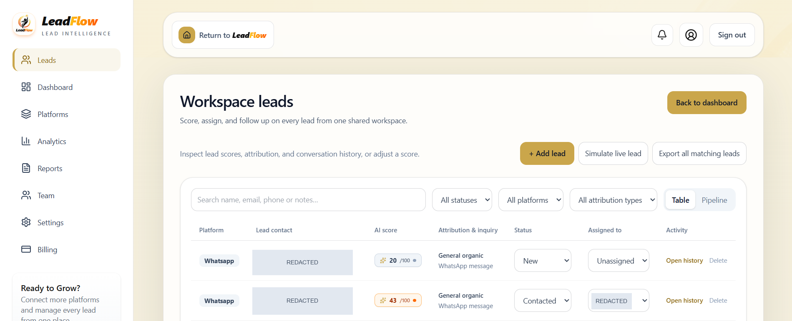
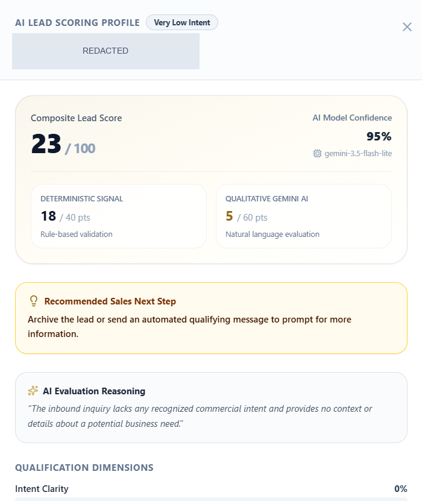

# LeadFlow Pro

**A shared workspace for capturing, qualifying, and following up on sales enquiries.**

[Zuhayr Mollagee](https://github.com/Zeebotx) · Lead System Developer · [Email](mailto:mollageezuhayr@gmail.com)

Next.js / React · Node.js / Express · PostgreSQL · Gemini

LeadFlow Pro brings social enquiries and manually entered leads into a workspace where teams review priority, assign follow-up, and track activity. I worked across the frontend and backend from May–November 2026 as part of a collaborative project.

**Project ownership:** LeadFlow Pro is owned by **Maphikeng Innovation Hub**. I served as the **Lead System Developer**, responsible for the project’s code and technical implementation. The full application repository remains private because it belongs to the Hub; sharing its source requires the Hub’s authorization.



*Application capture, 2 November 2026. Contact details are redacted.*

## My contribution

- Built account flows and dashboard views, then worked on social connections, webhook capture, and Gemini-assisted qualification.
- Added shared-workspace and team workflows, including invitations, recipient checks, workspace isolation, and migrations.
- Worked on email notifications, access-control fixes, and regression tests.

[Contribution details](docs/my-contributions.md)

## Two engineering problems

**Receiving an event safely before knowing where it belongs.** A valid webhook signature does not establish which workspace should receive the lead. The application persists events before acknowledgement, then rechecks account routing inside the capture transaction. Ambiguous mappings go to quarantine.

[Webhook routing, retries, and transaction boundaries →](docs/technical-challenges.md#1-webhook-retries-and-workspace-routing)

**Keeping a slow AI result from replacing a newer decision.** Scoring runs outside the database transaction. Before saving, the worker locks and rechecks the lead, discards stale results, and preserves a manager’s override. The remaining weakness is restart recovery for the in-memory scoring queue.

[Scoring concurrency and manual overrides →](docs/technical-challenges.md#2-stale-ai-results-and-manual-overrides)

## Inspect the public code

The full application is private. Two source-based adaptations show its [signed webhook inbox](examples/webhook-inbox.js) and [safe scoring writes](examples/lead-scoring.js), with a reduced PostgreSQL schema and synthetic inputs. Their [workflow tests](examples/workflows.test.js) exercise persistence, retries, routing changes, and scoring races.

Run with Node.js 22 or newer. Tests use an isolated embedded PostgreSQL database; no provider credentials are needed:

```sh
npm ci
npm test
```

[Example contracts and limitations](examples/README.md)

<details>
<summary>More application views</summary>



*Lead management: search, status, assignment, and history. Contact details and the assignee handle are redacted.*



*Scoring detail. Confidence is model-reported; predictive accuracy has not been measured.*

</details>

## Technical reference

[Architecture](docs/architecture.md) · [Database](docs/database-design.md) · [Scoring](docs/ai-lead-scoring.md) · [All reference notes](docs/README.md)

The case studies describe the implementation reviewed on 2 November 2026. Application tests were inspected, not executed for this portfolio; current deployment and live provider operation were not verified. Access to the private application source for technical review is subject to authorization from Maphikeng Innovation Hub.
