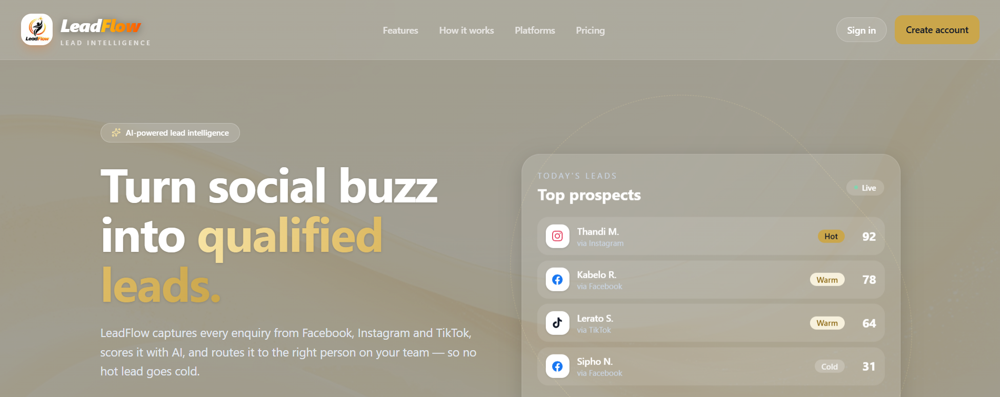
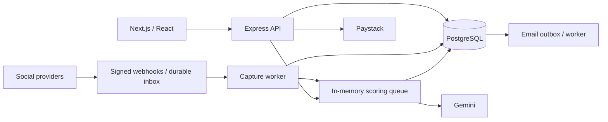

# LeadFlow Pro

**Zuhayr Mollagee · Lead Developer** · [GitHub](https://github.com/Zeebotx) · [Email](mailto:mollageezuhayr@gmail.com)

**Full-stack lead management with social integrations, AI-assisted qualification, and shared team workspaces.**

Next.js · React · Node.js · Express · PostgreSQL · Gemini

LeadFlow Pro brings social enquiries and manually entered leads into one sales workspace. Teams can prioritize enquiries, assign follow-up, track progress, and review campaign activity without switching between separate account inboxes.

**My contribution:** frontend and backend development across authentication, social integrations, webhook capture, lead scoring, workspaces, subscription billing, notifications, and regression testing. Development covered **May–November 2026**.

[My contributions](docs/my-contributions.md) · [Architecture](docs/architecture.md) · [Engineering challenges](docs/technical-challenges.md)

## Product preview

*Dashboard: recent incoming leads, scores, and follow-up status. Contact details are redacted.*

Explore lead management, scoring, and the landing page

### Lead management

*Workspace leads: search, filters, score inspection, status, assignment, and history. Contact details and the assignee handle are redacted.*

### Lead scoring

*Scoring detail: score components and model-generated reasoning. Identity is redacted. Displayed confidence is model-reported, not measured predictive accuracy; recommendations do not demonstrate that an action was executed.*

### Landing page

*Public landing-page design. Prospect cards are a marketing illustration, not authenticated lead records.*

*Owner-supplied captures received 2 November 2026; cropped for presentation, with solid redactions on authenticated views.*

## What I worked on

| Area | Contribution |
| --- | --- |
| Account and product experience | Login, registration, password recovery, dashboard routing, responsive navigation, account views, and accessible workspace interactions |
| Social integrations | TikTok and Instagram integration work, OAuth callbacks and popup connections, content synchronization, webhook setup, and inbound WhatsApp lead capture |
| Lead qualification | Gemini-assisted scoring integrated with local rules and a workflow for reviewing lead priority |
| Team workflows | Multi-tenant workspaces, team management, invitations, recipient checks, workspace isolation, and database migrations |
| Billing and notifications | Paystack subscriptions and pricing, subscription access checks, owner-only billing, Resend integration, and email alerts |
| Reliability and maintenance | Access-control and validation fixes, token revocation, rate limiting, regression-test improvements, shared UI styling, and developer guidance |

This was a collaborative project. The landing-page rebrand and Paystack billing commits include Claude co-authorship. See the [contribution breakdown](docs/my-contributions.md) for scope and attribution.

## Engineering problems worth discussing

The following examples explain the project implementation in areas connected to my contributions. Each links to the underlying technical case study.

### Keeping team data within its workspace

Moving from individual accounts to shared teams introduced membership, role, and assignment boundaries. The API validates the selected workspace and applies record-level access rules; database relationships reinforce same-workspace campaign links. This supports collaboration while restricting which records each user can access.

[Workspace boundaries and data model](docs/database-design.md) · [Authorization decisions](docs/engineering-decisions.md)

### Handling repeated webhook delivery

Social providers can redeliver events, and a worker can stop partway through processing. The application persists signed events in a PostgreSQL inbox before acknowledgement, then uses event identity, worker leases, and transactional capture to handle retries. Ambiguous account routing is quarantined for review.

[Webhook reliability case study](docs/technical-challenges.md#2-safe-routing-after-a-webhook-has-been-acknowledged)

### Keeping AI scoring reviewable

Lead qualification combines deterministic rules with Gemini evaluation of derived labels and metadata. Outputs are bounded and audited, and managers can override a score. Before writing a background result, the application rechecks the lead under a database lock so stale work does not displace a manual decision.

[Scoring workflow, privacy, and concurrency](docs/ai-lead-scoring.md)

## Product workflow

**Capture → qualify → assign → follow up → report**

- **Capture:** supported social events and manual entry become workspace leads.
- **Qualify:** rules and AI assistance help teams review priority, with score history and overrides.
- **Coordinate:** teams assign responsibility, update status, and keep follow-up notes.
- **Review:** campaign records, tracked content, charts, and owner exports provide operational visibility. Some content metrics are estimates.

## System architecture

The Express API owns authorization and business workflows. PostgreSQL stores application data and durable inbox/outbox state; scoring runs through a process-local queue. The [architecture document](docs/architecture.md) explains these boundaries and their trade-offs.

## Stack and testing

| Layer | Technologies |
| --- | --- |
| Frontend | Next.js App Router, React, JavaScript/JSX, Tailwind CSS, Recharts |
| Backend | Node.js, Express 5, REST APIs |
| Data | PostgreSQL, `pg`, numbered SQL migrations, JSONB |
| Authentication | bcrypt, JWTs, rotating refresh credentials, Google OAuth |
| Integrations | Meta, TikTok, inbound WhatsApp, Gemini, Paystack, Resend / SMTP |
| Tests | Jest, Supertest, PGlite database fixtures, Node test runner |

The source review recorded **23 backend and 3 frontend test files**, including workspace authorization, webhook processing, score updates, notifications, and UI interactions. These are inventory counts; tests were inspected rather than executed for this portfolio. No coverage percentage or production performance result is claimed.

## Explore the implementation

| Topic | Read more |
| --- | --- |
| Contribution and progression | [My contributions](docs/my-contributions.md) · [Development journey](docs/development-journey.md) |
| System design | [Architecture](docs/architecture.md) · [Database design](docs/database-design.md) · [API overview](docs/api-overview.md) |
| Technical reasoning | [Engineering decisions](docs/engineering-decisions.md) · [Technical challenges](docs/technical-challenges.md) |
| Educational code | [Five runnable JavaScript examples and 23 checks](examples/README.md) |
| AI and external services | [Lead scoring](docs/ai-lead-scoring.md) · [Integrations](docs/integrations.md) |
| Access and data handling | [Security and privacy](docs/security-and-privacy.md) |

## Project access and status

This repository is a documentation portfolio; the application source is private. Source access may be provided for technical review upon request. The technical case studies describe the implementation reviewed on **2 November 2026**. Current deployment, live provider approvals, and measured business outcomes have not been verified for this portfolio.

Review scope and supporting material

[Verification and publication review](docs/verification-and-publication-review.md) · [License review](LICENSE-REVIEW.md) · [Diagrams](assets/diagrams/README.md) · [Screenshot capture guide](screenshots/README.md) · [Educational examples](examples/README.md)

