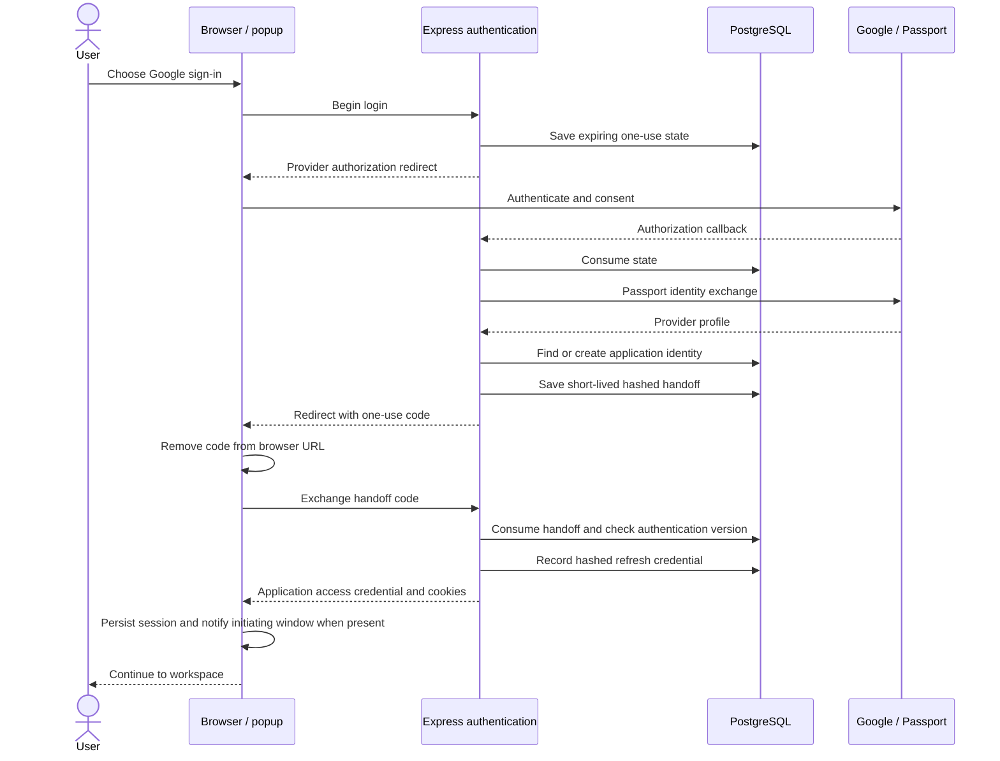

# Google login and application session

[Diagram index](README.md) · [Security](../../docs/security-and-privacy.md)

The browser watcher checks message origin and popup source. The application then uses its own JWT and refresh lifecycle, not a Google bearer credential for lead APIs. Ordinary email/password login reaches that session model through bcrypt verification instead of the provider/handoff sequence.

The state implementation has cookie-correlation and compatibility behavior; this diagram does not claim unconditional browser binding. Provider verification, automatic account matching policy, popup restrictions, and deployed cookie/origin settings need appropriate review. The sequence describes the successful source path, with failure/revocation branches summarized in the security document.

Private evidence: `backend/routes/oauthRoutes.js`; `backend/config/passport.js`; `backend/middleware/oauthState.js`; `backend/controllers/oauthController.js`, `authController.js`; `frontend/src/app/auth/google/callback/page.js`; `frontend/src/lib/popupAuth.js`, `session.js`.
