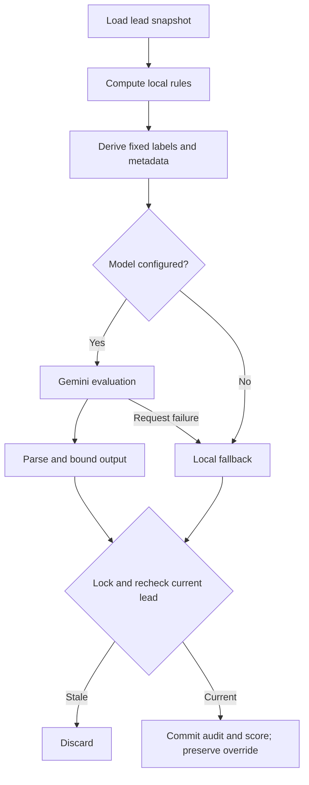

# AI-assisted lead scoring

[Portfolio](../README.md) · [Concurrency case study](technical-challenges.md#2-stale-ai-results-and-manual-overrides)

Scoring combines local rules with Gemini evaluation to give sales staff a reviewable priority signal. Managers can inspect the breakdown and apply an override with a rationale.

## Evaluation pipeline

## Model input

Local rules consider contact completeness, email-domain category, attribution, and recorded interactions. The model receives locally derived intent labels, an allowlisted platform, email-domain category, phone-presence flag, bounded interaction count, and an injection-warning flag. Arbitrary custom fields are replaced with an empty object.

Raw enquiries, names, actual contact values, and arbitrary campaign/source text stay out of this payload. The application database still stores contact and message data. Fixed labels reduce external disclosure but also remove detail the model might otherwise use to interpret an enquiry.

## Aggregation and normalization

The service combines deterministic and qualitative contributions into a bounded 0–100 score and derives an intent tier. It normalizes numerical fields, limits explanations, and defaults missing fields. Confidence and dimensions are explanatory model outputs; they have not been calibrated against a labelled dataset.

| Condition | Behavior |
| --- | --- |
| Model unconfigured | Local fallback; AI status skipped |
| Request error or deadline | Local fallback; AI status failed |
| Nonempty, unparseable output | Invalid normalized result with zero qualitative contribution |
| No usable output text | Local fallback branch can apply |
| Changed lead content or workspace | Discard result under a row lock |

## Persistence and scheduling

Score history stores component values, reasoning, model/prompt labels, telemetry, and minimized input snapshots. Audit insertion and effective-score update share a transaction. A manager’s current override retains precedence.

The process-local queue limits concurrency, suppresses active duplicates, skips unchanged content, and applies rescore cooldowns. WhatsApp updates during active work request another pass. Pending jobs are lost on restart; stale rejection does not schedule a replacement for every edit path.

Relevant private modules: `deterministicScoring.js`, `piiSanitizer.js`, `geminiScoringService.js`, and `scoringQueue.js`. Inspected tests cover constructed model payloads, normalization, and overrides during scoring. Predictive quality and conversion uplift have not been measured.
