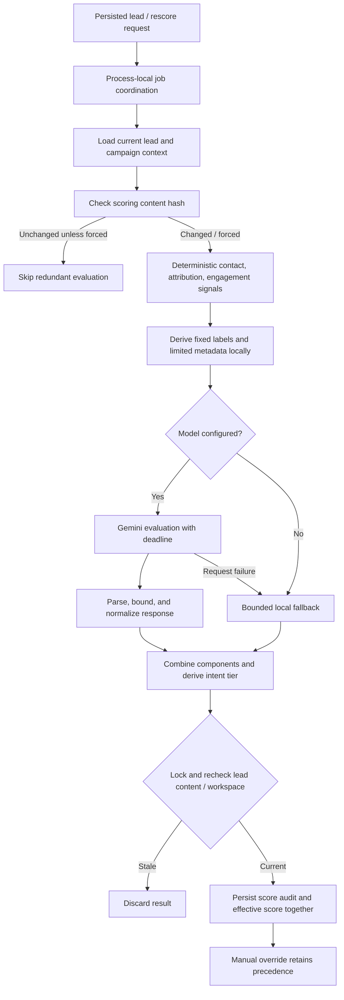

# AI-assisted lead scoring

[Portfolio](../README.md) · [Technical challenges](technical-challenges.md)

## Purpose and boundaries

Scoring gives sales staff a reviewable priority signal alongside enquiry history and contact information. It does not autonomously convert leads, make credit decisions, or prove commercial intent. This is a hybrid of local rules and an external language-model evaluation, not independently trained machine learning.

The private prompt text, detailed scoring weights, provider credentials, and real enquiries are excluded from this portfolio. The following explains public architecture and behavior without reproducing the proprietary policy.

## Evaluation pipeline

## Deterministic component

The local evaluator considers contact completeness and email-domain category, attribution/source, and recorded interactions. It returns a bounded contribution, a breakdown, and positive/negative signals. Domain classification is heuristic; a syntactically valid corporate-looking address is not proof of domain ownership, deliverability, or identity. Reserved/test and disposable categories have their own treatment.

Contact details are evaluated locally. Campaign attribution and repeated interaction can inform priority, but the scoring module itself is not a campaign-validity oracle. Relationship validation belongs to lead writes and database constraints. Recorded interaction count is an application signal, not independently verified customer engagement.

## What crosses the AI boundary

The payload builder reduces sanitized enquiry text to a fixed vocabulary of business-intent labels. The actual provider request receives those labels, an allowlisted platform category, email-domain category, phone-presence flag, bounded interaction count, and an injection-warning flag. Arbitrary custom fields are replaced with an empty object.

Names, actual contact addresses/numbers, raw enquiry text, arbitrary campaign names, and free-form source values are not forwarded by this payload builder. This is data minimization through representation, rather than an assertion that a general redaction model can remove every identifier. The backend and database still hold personal information, and derived metadata still requires an appropriate privacy review.

This narrow input limits model judgement. It cannot reliably infer an exact budget, team size, language quality, or detailed organizational fit from data it never receives. The provider is not analysing the complete original message. Confidence and dimension scores are bounded outputs, not statistically calibrated probabilities demonstrated against a labelled dataset.

## Aggregation and normalization

The service adds the deterministic and qualitative contributions, rounds/bounds supported numeric fields, clamps the overall score to a 0–100 scale, and derives one of five ordered intent tiers: very low, low, medium, high, or very high. Confidence and dimension values are normalized to bounded decimal values; text explanations and signals are limited and defaulted where needed. The dimension values are explanatory metadata rather than an additional independent sum added to the final score.

The model's returned score is not accepted as unrestricted authority. JSON parsing and normalization remain local. Numeric/text fields may be defaulted even when a returned object is considered valid, so a completed status does not prove a rich or accurate evaluation.

## Failure behavior

| Condition | Current behavior | Interpretation |
| --- | --- | --- |
| No model credential | Local fallback score and `skipped` AI status | Qualification can proceed without a provider call |
| Request error or deadline | Failed AI status with bounded local fallback | A result may remain useful, but does not represent successful AI evaluation |
| Nonempty output that cannot be parsed | Invalid normalized result with zero qualitative contribution; failed AI status | This path differs from the ordinary request-failure fallback |
| Completed request without usable text | Local fallback branch can be used | Status/model metadata should be interpreted with care |
| Content or workspace changes while model is running | Result discarded as stale under a row lock | Stale computation is prevented from replacing current state |
| Repeated database/job failure | Bounded retries, then failed score status | Not a durable distributed retry queue |

The model setting is configurable. A hardcoded model name or fallback constant in source is not evidence that a model is available in a live account. Deadline handling races a timer against the call; provider cancellation and billing behavior were not verified.

## Human control and auditability

Managers can apply a numeric override with a rationale. The controller rounds and stores the effective score, override author/reason, and a history event in one transaction. A background result uses the current manual override when updating effective priority, preserving a decision entered while AI work was in flight.

Historical score records keep component values, reasoning, signals, normalized dimensions, model/prompt version labels, token/latency metadata, deterministic breakdown, minimized input snapshot, and returned model text when present. These records support investigation, not immutable regulatory logging: they are ordinary database records with deletion relationships. An input snapshot is a minimized model payload, not a full lead copy.

The UI distinguishes score history, explanations, and overrides, but also has display defaults before complete audit data exists. A badge or default chart is not a substitute for the persisted audit. A manual score and an earlier model intent tier can describe different moments; review them together.

## Scheduling and limits

Creation/capture schedules work after lead persistence. Active IDs suppress duplicate jobs within the process; a content hash skips unchanged work unless forced. Manual rescoring has a cooldown. WhatsApp updates arriving during active work request a follow-up pass so the newest context can be evaluated. State for jobs, active IDs, follow-up requests, and cooldowns is in memory.

No durable recovery scan, cross-replica job coordination, fairness evaluation, predictive-quality benchmark, or measured conversion uplift was established. The architecture trades semantic detail for a narrower external-data boundary. That trade-off is an interpretation of observed code and privacy tests; it is not a claimed historical team decision.

## Evidence locators

Private source: `backend/services/deterministicScoring.js`, `piiSanitizer.js`, `geminiScoringService.js`, `scoringQueue.js`; `backend/controllers/leadActivityController.js`, `leadsController.js`; migration `010_create_lead_scoring_system.sql`; `frontend/src/components/LeadScoreDrawer.js`, `ManualOverrideModal.js`, `LeadScoreBadge.js`.

Assertions inspected: `backend/tests/deterministicScoring.test.js`, `geminiScoring.test.js`, `piiSanitizer.test.js`, `modelPrivacy.test.js`, `scoringQueue.test.js`, `leadScoringApi.test.js`, `whatsappScoring.test.js`. The model-privacy test checks the constructed SDK request; the override-race test checks persistence while scoring is in flight. None was freshly executed for this portfolio.
