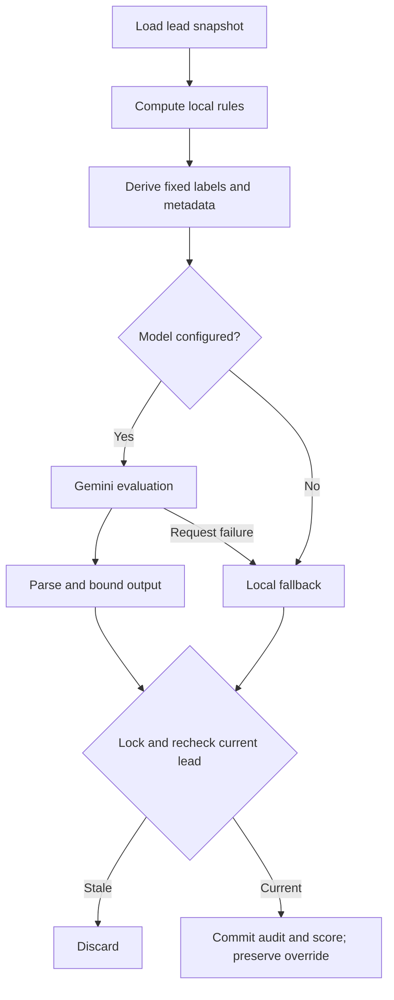

# AI-assisted lead scoring

[Portfolio](../README.md) · [Concurrency case study](technical-challenges.md#2-stale-ai-results-and-manual-overrides)

Scoring combines local rules with Gemini evaluation to give sales staff a reviewable priority signal. Managers can inspect the breakdown and apply an override with a rationale.

## Evaluation pipeline

## Model input

Local rules consider contact completeness, email-domain category, attribution, and recorded interactions. The model receives locally derived intent labels, an allowlisted platform, email-domain category, phone-presence flag, bounded interaction count, and an injection-warning flag. Arbitrary custom fields are replaced with an empty object.

Local extraction turns enquiry text into fixed intent labels before the provider request. Names, actual contact values, raw enquiries, and arbitrary campaign/source text stay in the application; the model receives the derived labels and limited metadata.

## Aggregation and normalization

The service combines deterministic and qualitative contributions into a bounded 0–100 score and derives an intent tier. It normalizes numerical fields, limits explanations, and defaults missing fields. Model-reported confidence and dimensions accompany the score as explanatory metadata.

| Condition | Behavior |
| --- | --- |
| Model unconfigured | Local fallback; AI status skipped |
| Request error or deadline | Local fallback; AI status failed |
| Nonempty, unparseable output | Invalid normalized result with zero qualitative contribution |
| No usable output text | Local fallback branch can apply |
| Changed lead content or workspace | Discard result under a row lock |

## Persistence and scheduling

Score history stores component values, reasoning, model/prompt labels, telemetry, and minimized input snapshots. Audit insertion and effective-score update share a transaction. A manager’s current override retains precedence.

The process-local queue limits concurrency, suppresses active duplicates, skips unchanged content, and applies rescore cooldowns. WhatsApp updates during active work request another pass. PostgreSQL retains the last scoring hash, score history, and effective priority used by the interface.

Relevant private modules: `deterministicScoring.js`, `piiSanitizer.js`, `geminiScoringService.js`, and `scoringQueue.js`. Application regression assertions cover constructed model payloads, normalization, and overrides during scoring.
