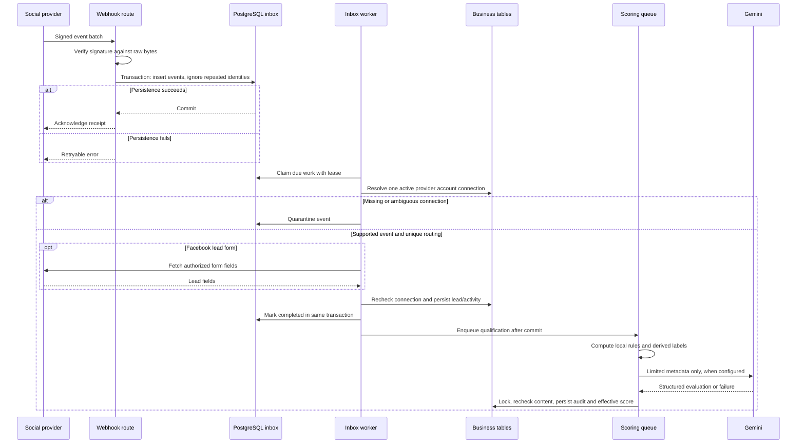

# Architecture

[Portfolio](../README.md) · [Diagram index](../assets/diagrams/README.md)

Reviewed on 2 November 2026. Statements below describe executable source and migrations, rather than a verified deployed topology.

## System shape

LeadFlow Pro has a Next.js browser interface and an independently composed Express backend. PostgreSQL holds business records, identities, integration connections, durable webhook work, and email work. Provider requests and Gemini evaluation run in the backend. The application is a single backend process with service modules and workers, not a collection of deployed microservices.

The main README provides the high-level component diagram. The important boundary is between a browser request, a committed database change, and a later external side effect. A lead can exist before a scoring result is available; an inbox acknowledgement means the event was persisted, not that qualification has finished.

## Frontend responsibilities

The App Router organizes public, authentication, workspace, lead, analytics, platform, team, and billing screens. The root layout wraps content in `WorkspaceProvider`. Protected path selection and navigation gates live in that provider; individual account/invitation screens also perform session work. These UI checks guide navigation; the API remains the authority for access.

State uses React context, state, effects, refs, and local component data. On a workspace change, children are keyed by workspace ID and remounted. This limits retention of the preceding workspace's page state. The shared API client includes the selected workspace header, bearer credential, and cookies, deduplicates concurrent GET requests by request context, and coordinates refresh attempts through one shared promise. It retries eligible requests once after refresh. This is in-flight coordination, not a persistent response cache.

Lead tables, score drawers, pagination controls, and connection forms are reusable components. A shared modal frame handles focus containment, Escape, scroll locking, and restoration. The dashboard dynamically imports its chart component. Tailwind utilities and shared global CSS coexist with older per-screen styling. No external state store or Next.js API route backend was identified.

## Backend composition and request lifecycle

`server.js` assembles CORS, JSON parsing, raw-body retention, cookies, origin checks, Passport initialization, API routers, webhook routers, and final error handlers. Routes usually pass through these stages:

1. Verify the access token and current user authentication version.
2. Resolve the selected workspace and verify membership.
3. Check the workspace owner's subscription when required.
4. Apply the route role gate and controller-level assignment/relationship checks.
5. Validate data, execute parameterized SQL, and use a transaction for coordinated changes.
6. Commit and return JSON, then enqueue asynchronous work where the workflow requires it.

Billing endpoints deliberately allow the verified owner to recover access by paying without first passing the ordinary subscription gate. Invitation preview/acceptance and workspace bootstrap also have distinct access paths. They should not be described as ordinary management endpoints with identical middleware.

Controllers coordinate HTTP behavior and business writes; services encapsulate scoring, providers, inbox/outbox work, and billing. SQL appears in controllers, middleware, routes, and services through a shared `pg` pool. There is no ORM or repository abstraction. This makes transaction boundaries explicit while spreading query responsibility across modules.

## Lead ingestion sequence

The inbox worker uses a lease and `SKIP LOCKED` claiming. Transactional rechecks guard against a connection changing after initial lookup. Unsupported events and ambiguous accounts are quarantined rather than assigned to an arbitrary workspace. Processing errors schedule bounded retries. The event-to-lead unique reference protects capture from repeated processing.

WhatsApp adds conversation identity: a sender maps to one lead per workspace, messages append history, and message time controls the latest scoring context. Manual entry instead performs a same-platform contact/name match and retains linked duplicate records. These workflows should not be collapsed into one universal duplicate detector.

## Authentication and external services

Email/password login uses bcrypt and a short-lived JWT with refresh rotation. Google login uses Passport without mounted server session middleware, followed by a one-use code exchange. Social connection OAuth stores selected-workspace state and rechecks management access when the callback returns. See the [authentication sequence](../assets/diagrams/authentication.md) and [integration workflows](integrations.md).

OAuth credentials for connected social accounts are encrypted before persistence. Google sign-in is an identity feature, not an analytics platform connector. Paystack handles commercial subscription workflows. Resend or SMTP delivers transactional mail. MCP is development tooling outside the application runtime; it is not a production API adapter.

## Background work and failure semantics

| Component | State and recovery | Practical limit |
| --- | --- | --- |
| Webhook inbox | PostgreSQL job status, due time, attempts, lease, quarantine, transactional capture | Requires a running backend and operational handling of failed/quarantined work |
| Scoring queue | In-memory jobs, active IDs, content hashes, bounded concurrency/retries, rescore cooldown | Jobs and coordination state do not survive process restart or coordinate across replicas |
| Email outbox | Trigger-enqueued rows, leased delivery, retained message, recipient recheck, retry state | Provider acknowledgement and inbox receipt differ; SMTP does not share Resend idempotency semantics |
| Content auto-sync | Browser timer invokes the sync API when enabled | Requires the page to remain open; no independent scheduler was found |

The scoring call has a deadline and fallback paths, but a timeout race is not proof of provider request cancellation. Some analytics errors become empty successful responses, so empty results cannot alone establish that a connection is healthy. Logging is primarily console diagnostics and database work status; centralized telemetry and alerting were not established.

Startup checks for the migration-019 ledger entry before listening and starting workers. It does not apply migrations. The migration runner is a separate operational action. No build, startup, migration, or provider call was executed for this portfolio.

## Architectural interpretation

The arrangement supports explicit transactions and small operational scope without introducing a broker. That benefit is an interpretation of the implementation, not proof that the team evaluated particular alternatives. Durability is strongest around external capture and queued mail; scoring remains a simpler process-local component. Distributed scheduling, measured throughput, and seamless horizontal scaling are not established properties.

## Evidence locators

Private source: `backend/server.js`; `backend/routes/`; `backend/middleware/authMiddleware.js`, `teamMiddleware.js`; `backend/utils/getWorkspaceContext.js`; `backend/services/webhookInbox.js`, `whatsappCapture.js`, `scoringQueue.js`, `emailOutbox.js`; `frontend/src/app/layout.js`; `frontend/src/components/WorkspaceProvider.js`, `ModalFrame.js`; `frontend/src/lib/api.js`, `session.js`, `popupAuth.js`; `frontend/next.config.mjs`.

Relevant test assertions: `backend/tests/workspaceDatabase.test.js`, `workspaceAccess.test.js`, `frontendClient.test.js`, `emailOutbox.test.js`, `whatsapp.test.js`; `frontend/tests/modalFrame.test.cjs`, `popupAuth.test.cjs`. These files were inspected; their presence does not establish a passing run for the reviewed snapshot.
