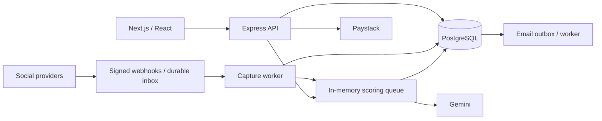

# Architecture

[Portfolio](../README.md) · [Technical reference](README.md)

LeadFlow Pro uses a Next.js browser interface and a separate Express backend. PostgreSQL stores business records, identities, provider connections, and durable delivery work. Service modules and workers run within the backend.

## System architecture

## Frontend responsibilities

App Router pages cover authentication, leads, analytics, platforms, teams, and billing. React context carries the current workspace. Changing workspace remounts its page subtree to clear the preceding page state.

The shared API client sends the workspace header, bearer credential, and cookies. It shares identical pending GET requests by context, coordinates token refresh through one promise, and retries eligible requests once. This coordination ends when a request settles. A shared modal handles focus containment, Escape, scroll locking, and focus restoration.

## Request flow

Protected requests verify identity, resolve workspace membership, check subscription access where required, then apply role and record-level rules. Controllers validate input and issue parameterized SQL through `pg`. Transactions cover related writes. Billing recovery and invitation/bootstrap routes have their own access paths.

SQL is spread across controllers, middleware, routes, and services. The transaction boundaries are explicit, but changing data-access rules requires checking several modules.

## Lead ingestion sequence

Signed events commit to the inbox before acknowledgement. A worker claims an event, resolves and rechecks the active connection, then commits lead/activity capture and event completion together. Scoring begins after commit. [The webhook case study](technical-challenges.md#1-webhook-retries-and-workspace-routing) explains retries and ambiguous routing.

## Background work

| Component | Stored state | Failure boundary |
| --- | --- | --- |
| Webhook inbox | PostgreSQL events, attempts, leases, and quarantine | Requires a running worker and failed-work handling |
| Scoring queue | In-memory jobs, active IDs, hashes, and cooldowns | Restart loss; no cross-process coordination |
| Email outbox | PostgreSQL jobs, retained messages, attempts, and leases | Provider acknowledgement differs from recipient delivery |

The email worker rechecks recipient eligibility before sending. Enqueueing happens in the lead transaction; remote delivery happens later. Model calls likewise happen outside the score-write transaction.

Implementation references: backend `server.js`, `webhookInbox.js`, `scoringQueue.js`, `emailOutbox.js`; frontend `WorkspaceProvider.js` and `api.js`. See [database relationships](database-design.md) and [integration workflows](integrations.md) for supporting detail.
