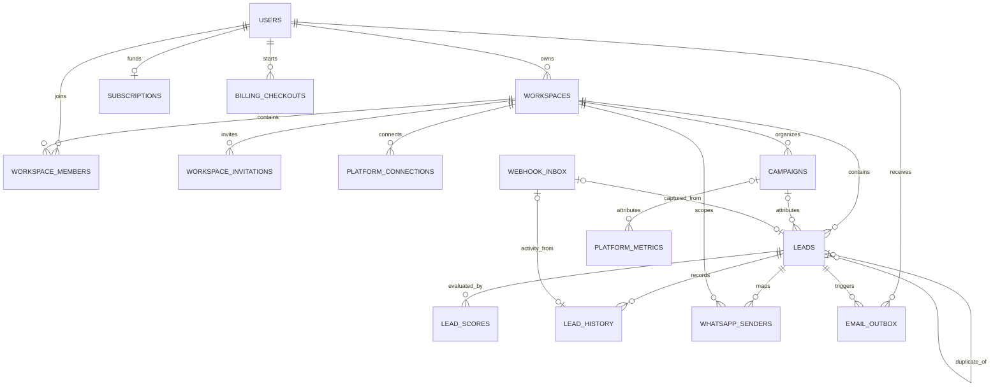

# Database design

[Portfolio](../README.md) · [Architecture](architecture.md)

## Authority and access

The application uses PostgreSQL through `pg`, issuing direct parameterized SQL. The base user schema plus migrations 001–019 define the reviewed database model. A live database was not queried, so this document describes the intended migrated schema rather than certifying a deployed instance.

The tenant boundary is a workspace. A record's creator `user_id` is a different concept from its `workspace_id`; neither is a substitute for the other. Membership provides the workspace role, while `assigned_to` controls ordinary agent visibility. Custom JWT/Passport authentication uses integer application users, not Supabase Auth UUIDs.

## Major entities

| Entity/table | Primary identity | Responsibility and relationships |
| --- | --- | --- |
| `users` | Serial `id` | Unique email and nullable unique provider identities, password hash, profile and authentication version |
| `workspaces` | Serial `id` | Owner user FK; nullable unique personal-user FK; workspace alert preference |
| `workspace_members` | Serial `id`; unique workspace/user pair | User and workspace FKs; checked Owner, Sales Manager, Sales Agent, Viewer roles |
| `workspace_invitations` | Serial `id`; unique token | Workspace and inviter FKs, recipient email, role, status, expiry |
| `platform_connections` | Serial `id` | Creator and workspace FKs, provider account identity, encrypted credentials, expiry and connection status |
| `campaigns` | Serial `id` | Workspace and creator FKs; local budget, dates, platform, lifecycle and counters |
| `leads` | Serial `id` | Workspace/creator FKs, optional campaign, optional assignee/override author, duplicate self-reference and unique optional inbox reference |
| `lead_scores` | Serial `id` | Lead and creator FKs, historical score components, explanations, model telemetry and structured snapshots |
| `lead_history` | Bigserial `id` | Lead/workspace FKs, nullable actor FK, checked activity type, JSONB details and optional unique inbox reference |
| `platform_metrics` | Serial `id` | Workspace/creator FKs, optional campaign FK, content identity and metrics |
| `webhook_inbox` | Bigserial `id` | Unique provider/event-key pair; payload, account, optional resolved workspace, processing state and lease |
| `whatsapp_senders` | Composite workspace/sender PK | Composite FK to lead ID/workspace, providing conversation identity within a tenant |
| `subscriptions` | User FK as PK | One subscription record per paying user; checked plan/status, period and provider references |
| `billing_checkouts` | Text reference PK | User FK, plan, kind, expected amount and completion state |
| `billing_events` | Bigserial `id`; unique dedupe key | Payment event processing deduplication; not an FK-linked checkout ledger |
| `email_outbox` | Bigserial `id` | Workspace, lead and recipient FKs; unique triple; delivery attempts, retained message and provider acknowledgement |

Authentication support also includes `refresh_tokens` (serial PK, unique token hash, user FK), `oauth_states` (hash PK, optional user/workspace FKs), and `oauth_handoffs` (hash PK, user FK). Legacy `linking_requests` and `webhook_events` remain defined but are not the current webhook capture architecture. `migration_reference_issues` records detached legacy campaign references and has no declared primary key. `schema_migrations` is the runner's filename-keyed ledger.

## Core relationship diagram

This is a selected physical relationship view. It intentionally omits some creator, actor, authentication, and operational relationships for legibility. Each line represents an actual foreign key; uniqueness of membership and other compound keys is described below.

An inbox event may produce a lead, an activity, both, or no business row, depending on provider and event. The separate unique nullable inbox FKs do not establish a universal one-event/one-row relationship across both tables. A sender mapping references exactly one lead; the schema does not make `lead_id` unique in that mapping table.

## Integrity constraints

Migration 013 makes workspace references mandatory on leads, campaigns, and metrics, introduces current role labels, and adds `UNIQUE(id, workspace_id)` to campaigns. Composite foreign keys from leads and metrics require their optional campaign to belong to the same workspace. They are deferrable, which supports coordinated personal-to-shared workspace moves inside a transaction.

Migration 014 moves platform connections from a user/provider uniqueness rule to a workspace/provider/account rule. Migration 016 additionally makes each WhatsApp receiving account globally unique among WhatsApp connections. Its sender map has a workspace/sender primary key and a composite lead/workspace FK with delete/update cascades.

The database checks role labels, invitation states, inbox states, billing plan/status values, and history event types. Lead status and score ranges are substantially enforced in application code; this document does not claim SQL CHECK constraints for every validated field. The score columns are integers; confidence/dimensions are numeric, and audit details use JSONB.

Deletion behavior varies. Many ownership FKs cascade; lead campaign, assignee, duplicate-origin, and override-author references can be set null as defined by their FKs. History actor deletion preserves the activity with a null actor, whereas deleting a lead cascades its history/scores. These are operational histories, not an immutable archive independent of record deletion. Timestamps include both TIMESTAMP and TIMESTAMPTZ; there is no universal automatic `updated_at` trigger.

## Indexes and query patterns

| Pattern | Declared support | Limit |
| --- | --- | --- |
| Workspace lists and assignment | Workspace/assignee indexes added with team support | Actual plans and production selectivity were not measured |
| Duplicate matching | Partial duplicate-check and lower-email indexes | Older indexes retain creator-oriented columns; name/email/phone matching is heuristic, not a unique person constraint |
| Latest score/history | Lead/created-time indexes for scores; lead/ID history index | A composite covering index for every join/order is not implied |
| Inbox polling | Status/due-time index and unique provider/event key | Retention and large backlogs need operational policy |
| Email delivery | Partial due-time/ID index; unique workspace/lead/recipient | Suppression is once per triple, not a fresh email on every threshold crossing |
| Content tracking | Workspace/platform/campaign indexes | No unique content URL constraint; check-then-write sync can race |

JSONB supports custom fields, payloads, activity details, and score snapshots. No general GIN indexing strategy was found in the migration history. Normalized workspace membership and explicit relationships carry authorization-sensitive identity; flexible metadata stays in JSONB. This is an observed modelling choice, not evidence of measured performance superiority.

## Migrations and security boundary

The runner takes an advisory lock, creates the base schema and migration ledger, sorts SQL filenames, and applies each unapplied migration in its own transaction. Filenames are recorded after success. Some historical migrations move or delete data, so running the full set is an operational change requiring review, not a harmless inspection step. Startup checks the latest required filename but does not prove every constraint is present or automatically migrate.

RLS is enabled on application tables in migrations. Application authorization is implemented in Express and SQL predicates; the migrations do not define a browser-facing per-user Supabase Auth policy model. Effective database privileges and deployed roles must be checked separately. No application `pg` role or hosted policy configuration was inspected.

Older specifications describe a conceptual 16-entity model and a seven-table operational model. Neither is a complete description of the current migrated schema. Planned automation, tag, CRM-sync, and report entities must not be presented as implemented tables.

## Evidence locators

Private source: `backend/config/schema.sql`, `backend/config/db.js`, `backend/run_migration.js`; all `backend/migrations/001_*.sql` through `019_*.sql`, especially 010 and 012–019. Read-side evidence: `backend/controllers/leadsController.js`, `campaignsController.js`, `leadActivityController.js`, `leadExportController.js`; `backend/routes/workspaceRoutes.js`.

Constraint/transaction assertions: `backend/tests/databaseFixture.js`, `workspaceDatabase.test.js`, `whatsapp.test.js`, `emailOutbox.test.js`. These use migrated PGlite fixtures; deployed PostgreSQL behavior, production query plans, backup/restore, and migration ledger were not verified here.
