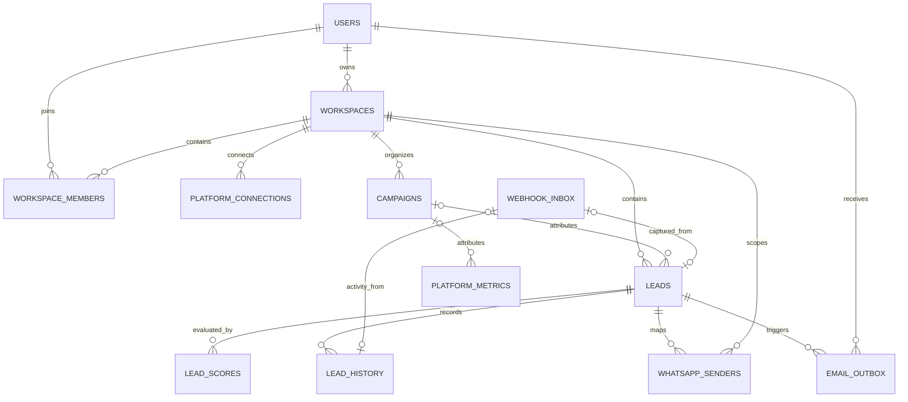

# Database design

[Portfolio](../README.md) · [Architecture](architecture.md)

PostgreSQL is accessed through parameterized `pg` queries and explicit transactions. The base schema and migrations 001–019 define the documented model.

## Tenant identity

`workspace_id` determines tenancy; creator `user_id` records authorship. Membership supplies role, and `assigned_to` restricts ordinary lead visibility. Personal records move into shared workspaces through an explicit import workflow.

## Core relationship diagram

Selected foreign-key relationships are shown; authentication, billing, invitation, and some actor relationships are omitted.

## Constraints that carry business rules

| Rule | Database support |
| --- | --- |
| Campaign and lead stay in one workspace | Composite campaign ID/workspace foreign keys; also used by content metrics |
| Membership is unique | Unique workspace/user pair |
| Provider redelivery does not create another inbox event | Unique provider/event key |
| Reprocessing does not repeat the same lead/activity capture | Separate unique nullable inbox references on leads and history |
| WhatsApp conversation stays within its workspace | Workspace/sender primary key and composite lead/workspace FK |
| Receiving WhatsApp account has one workspace | Unique receiving-account constraint |
| Alert is queued once per recipient for a lead | Unique workspace/lead/recipient triple |

The lead and activity inbox references are separate: one event may produce a lead, an activity, both, or neither. Manual entry also records repeat interactions by linking duplicate rows to an original lead and updating its interaction count.

## Transactions and migrations

Workspace import locks source and target, moves related business records in one transaction, clears assignments, and records history. Deferrable same-workspace campaign constraints support the coordinated move.

The dedicated migration runner takes an advisory lock, orders filenames, and applies each unapplied migration transactionally. Migrations define schema and data changes. Application startup verifies the required migration ledger entry before serving requests and starting workers.

JSONB holds payloads, custom fields, and score/history details. Due-work and lead/history indexes support polling and retrieval. Foreign-key deletion actions coordinate cleanup of related records.

Express membership and role checks combine with workspace-scoped SQL predicates and relational constraints to enforce the application’s access model. Migrations also enable row-level security on application tables.
