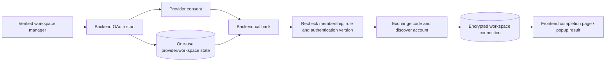

# External integrations

[Portfolio](../README.md) · [Architecture](architecture.md)

## How to read integration status

An implemented adapter proves there is code for a workflow. Mocked regression assertions prove what scenarios the tests express. Neither establishes current external approval, customer grants, registered callbacks, provider availability, or successful production delivery. No external service was called during this portfolio review. Earlier internal provider-tool observations were not refreshed or copied into the public material.

| Integration | Implemented workflow | Test evidence inspected | External conditions still unverified |
| --- | --- | --- | --- |
| Facebook / Meta | Management-gated OAuth, profile/Page discovery, encrypted connections, attempted Page subscription, signed capture, form-field retrieval, content reads | Callback redirects, signatures, durable inbox and workspace assertions | App/product access, customer Page grants, callbacks, real lead receipt and complete asset discovery |
| Instagram | OAuth through Meta or configured direct route, connected-account discovery, media/insight helpers, supported event capture | Callback flow and migrated inbox assertions; shared signature checks | Eligible account linkage, permissions, API versions, subscribed fields and live content/events |
| TikTok | Account-link OAuth, encrypted access/refresh storage, video listing, refresh-and-retry on unauthorized response, signed webhook normalization | Callback/signature tests and general provider handling assertions | Product approval, effective scopes, live lead-product payload compatibility and token expiry behavior |
| WhatsApp | Business phone verification, encrypted connection, signed inbound messages, per-workspace sender mapping and message history | Migrated database tests for redelivery, parallel capture, mapping, ordering and access | Business/number configuration, subscription and live phone-message delivery |
| Google OAuth | Passport sign-in, existing identity/email matching, short-lived one-use login handoff | Session/exchange-related source and callback/client assertions | Registered redirects, consent configuration and real sign-in |
| Gemini | External evaluation of minimized metadata with local normalization and fallback | Constructed-request privacy and score normalization assertions | Credential/model availability, quality, cost and live response behavior |
| Paystack | Checkout, transaction verification, recurring subscription/trial workflows, signed events and owner entitlement | Billing fixtures with mocked provider calls | Merchant configuration, plan references, real charge/refund and reconciliation |
| Resend / SMTP | Password reset, invitations, queued hot-lead alerts; provider-aware delivery results | Mail escaping/status tests and migrated outbox assertions | Sender verification, recipient delivery, bounce handling and provider account restrictions |

## Social OAuth lifecycle

Starts for social connections are management-gated and retain the selected workspace. Callback processing consumes provider-specific, expiring state and rechecks current management rights and subscription access. The state code contains browser-correlation handling, including a compatibility path when its cookie is absent; this review does not claim unconditional browser binding across every path.

Frontend popups open a local loading page before requesting the authorization URL, supporting browser popup constraints. The watcher checks both origin and the popup window source before handling completion, and cleans up timers/listeners. Completion signals update navigation; they do not independently prove that every provider asset was connected successfully.

## Provider-specific behavior

Facebook connection can save a user account and discovered Pages separately, deduplicating returned Page identities. It attempts Page webhook subscription where a Page token is available. Some discovery/subscription failures are caught without failing the overall callback. A successful connection message therefore needs confirmation through the intended Page and event flow.

Instagram supports both configured direct login and a Meta-dialog route. Account discovery checks Page-linked business accounts and business portfolio data, with fallback behavior. The stored account must still correspond to the intended Instagram asset. Insight helper routes exist but are not evidence that every metric is available under each login type or current permission set.

TikTok is an authenticated workspace connection, not the application's general login mechanism. Media retrieval can refresh the stored connection token after a 401 and retry the video request. Lead event normalization accepts selected shapes, but broad product compatibility and delivery are not proven by signature tests.

WhatsApp uses an explicit receiving phone-number ID plus access credential rather than the social OAuth buttons. The controller asks Meta for number metadata before saving. A partial unique database index prevents that receiving number being reused across workspaces. Captured messages append text/caption or media-type activity; the capture service does not download attachments or send outbound WhatsApp replies. Status-only notifications do not create leads.

Google is for identity. The callback creates a short-lived one-use handoff code, and the frontend exchanges it for the application's own session. It is not a Google Ads connector. Platform labels accepted by manual validation do not imply implemented LinkedIn, YouTube/Google Ads, or other platform integrations.

## Webhook and synchronization contracts

The webhook layer verifies signatures over retained raw bytes and persists social batches before acknowledgement. Jobs use provider/account/event identity and require one active matching connection. Missing, ambiguous, unsupported, or changed mappings do not silently route to another tenant. This is separate from the owner's content-sync request, which reads provider media through authorized connections and writes normalized `platform_metrics`.

Auto-sync is a browser timer, not a server schedule. Provider reads and HTML/oEmbed fallbacks can return partial data. Some view/share counts are estimated from engagement instead of returned measurement. Pagination completeness, rate limits, provider deprecation compatibility, and tracked-content ownership need further validation. The portfolio does not advertise precise cross-platform attribution or audited advertising ROI.

## Payments and email

Paystack initialization stores an expected local reference and amount; completion checks success, reference, amount, and currency before updating state. Subscription status feeds the workspace owner's entitlement and team limits. Signed billing events use a separate deduplication ledger from the social inbox. Database transactions cannot atomically encompass a remote charge, subscription creation, refund, and local commit. Operational reconciliation remains necessary; no exactly-once external-payment guarantee is claimed.

Resend is selected when configured; SMTP is an alternate configuration path. It is not safe to assume an ambiguous Resend failure immediately falls back to SMTP. Invitation and password-reset mail use direct transactional sends. Hot-lead alerts use the durable outbox, retained message, retries, recipient eligibility recheck, and a stable delivery key. SMTP acknowledgement and provider idempotency differ, and neither proves recipient inbox placement.

## Configuration and tooling

Configuration is injected through environment variables and local/deployment tooling. Representative names include `GOOGLE_CLIENT_ID`, `META_APP_ID`, `TIKTOK_CLIENT_KEY`, `WHATSAPP_GRAPH_VERSION`, `GEMINI_MODEL`, `PAYSTACK_PLAN_BASIC`, and `RESEND_FROM`. This is not a deployable environment template; no values, provider app IDs, tenant IDs, callback hosts, or merchant identifiers are included.

Meta MCP tools are developer-side inspection/configuration capabilities. They are not imported by LeadFlow Pro and do not replace a customer's production token grant. App-review access, effective token permissions, asset membership, and webhook receipt are separate evidence questions. Tool capability discovery during this review made no account calls or configuration changes.

## Evidence locators

Private source: `backend/controllers/facebookController.js`, `oauthController.js`, `whatsappController.js`, `instagramController.js`, `analyticsController.js`; `backend/routes/oauthRoutes.js`; `backend/middleware/oauthState.js`, `webhookSignature.js`; `backend/config/passport.js`, `mailer.js`; `backend/services/userService.js`, `platformMediaService.js`, `videoScraperService.js`, `platformHttp.js`, `webhookInbox.js`, `whatsappCapture.js`, `billing.js`, `paystack.js`, `emailOutbox.js`; `frontend/src/lib/popupAuth.js` and provider callback pages.

Test evidence: `backend/tests/platformCallbackRedirects.test.js`, `webhooks.test.js`, `workspaceDatabase.test.js`, `whatsapp.test.js`, `billing.test.js`, `mailer.test.js`, `emailOutbox.test.js`, `modelPrivacy.test.js`; `frontend/tests/popupAuth.test.cjs`. These are inspected assertions, not new live-service certifications.
