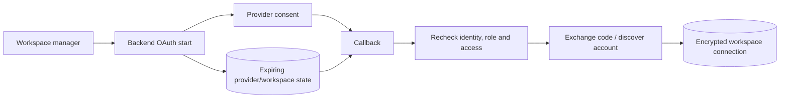

# External integrations

[Portfolio](../README.md) · [Architecture](architecture.md)

| Service | Implemented workflow | Processing details |
| --- | --- | --- |
| Facebook / Meta | OAuth, Page discovery, encrypted connections, signed lead capture, and content reads | Discover connected assets, retrieve lead-form fields, and route supported events to workspace leads |
| Instagram | Meta or configured direct OAuth, account discovery, media/insight helpers, and supported event capture | Resolve account connections and normalize provider content for analytics |
| TikTok | Account linking, video listing, token refresh/retry, and signed webhook normalization | Refresh stored connection credentials on supported unauthorized-response paths and retry content requests |
| WhatsApp | Receiving-number metadata verification, signed inbound messages, and workspace/sender mapping | Append timestamped message history and retain the newest text context for scoring |
| Google | Sign-in followed by a one-use application-session handoff | Exchange the provider identity for the application’s JWT and refresh lifecycle |
| Gemini | Evaluation of minimized metadata, output normalization, and local fallback | Combine qualitative evaluation with deterministic signals and persist a reviewable score |
| Paystack | Checkout, verification, subscriptions, signed events, and entitlement | Validate payment reference, amount, currency, and success before updating subscription access |
| Resend / SMTP | Recovery, invitations, and queued lead alerts | Send transactional messages and retain hot-lead delivery state in the outbox |

These adapters connect provider-specific authentication and payloads to the application’s workspace, lead, metric, subscription, and email workflows.

## Social OAuth lifecycle

Frontend popup handling checks message origin and source window and cleans up listeners/timers. Callback processing consumes expiring state and rechecks current management rights. Browser correlation includes a compatibility path when its cookie is absent.

Content sync reads authorized provider media into normalized metrics. When enabled, browser auto-sync invokes the sync API on a page timer. Stored metrics combine provider-returned values and estimates in the adapter paths that derive counts from engagement.

## Payments and email

Payment completion checks reference, amount, currency, and provider success before updating local state. Billing events use a deduplication ledger, while subscription state drives plan-based workspace access.

Recovery and invitation email send directly. Lead alerts use a durable outbox with leases, retries, a retained message, and an eligibility recheck before send. The worker records delivery state and provider acknowledgement. See [engineering decisions](engineering-decisions.md) for the supporting implementation patterns.
