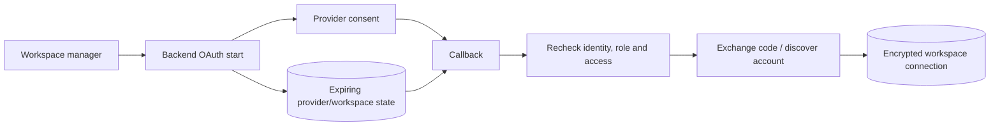

# External integrations

[Portfolio](../README.md) · [Architecture](architecture.md)

| Service | Implemented workflow | Important boundary |
| --- | --- | --- |
| Facebook / Meta | OAuth, Page discovery, encrypted connections, signed lead capture, content reads | Discovery/subscription can partially fail without failing the overall callback |
| Instagram | Meta or configured direct OAuth, account discovery, media/insight helpers, supported event capture | Account eligibility and grants determine available assets and metrics |
| TikTok | Account linking, video listing, token refresh/retry, signed webhook normalization | Supported payload shapes do not establish compatibility with every lead product |
| WhatsApp | Verified receiving-number metadata, signed inbound messages, workspace/sender mapping | Inbound capture only; attachments are not downloaded and replies are not sent |
| Google | Sign-in followed by a one-use application-session handoff | Identity integration, not an advertising connector |
| Gemini | Evaluation of minimized metadata, normalization, local fallback | Quality remains unbenchmarked |
| Paystack | Checkout, verification, subscriptions, signed events, entitlement | Remote payment effects require reconciliation with local state |
| Resend / SMTP | Recovery, invitations, queued lead alerts | Provider acceptance does not establish recipient delivery |

These describe implementation paths. Current provider approvals, grants, registered callbacks, and live delivery were not verified for this portfolio.

## Social OAuth lifecycle

Frontend popup handling checks message origin and source window and cleans up listeners/timers. Callback processing rechecks current management rights. Browser correlation includes a compatibility path when its cookie is absent.

Content sync reads authorized provider media into normalized metrics. Browser auto-sync is a timer; some metrics use estimates and some discovery is partial. A successful connection does not establish complete content acquisition or marketing attribution.

## Payments and email

Payment completion checks reference, amount, currency, and provider success before updating local state. Billing events use their own deduplication ledger. A local transaction cannot atomically encompass remote payment and subscription effects.

Recovery and invitation email send directly. Lead alerts use a durable outbox with leases, retries, a retained message, and an eligibility recheck before send. Resend’s delivery key and SMTP acknowledgement have different semantics. See [engineering trade-offs](engineering-decisions.md).
